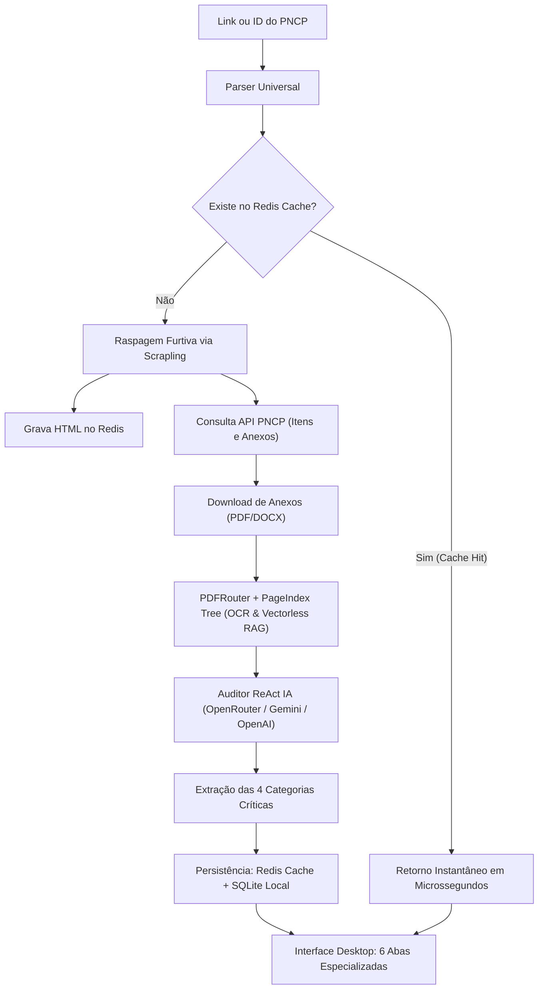

# ⚡ Zeno Licitações: Inteligência e Auditoria de Editais com IA

> **Manual de Capacidades e Arquitetura do Sistema**  
> Plataforma corporativa de inteligência jurídica, monitoramento contínuo e auditoria profunda de licitações públicas brasileiras (PNCP, Compras.gov e portais integrados).

---

## 🎯 O que o Sistema Faz?

O **Zeno Licitações** transforma a rotina de análise de editais públicos. Em vez de ler manualmente centenas de páginas em arquivos PDF, o sistema automatiza a raspagem, a extração, o processamento de linguagem natural e o checklist de habilitação, entregando em segundos uma **auditoria executiva completa focada em proteger o cliente de armadilhas e riscos**.

---

## 1. 🔍 Scan por Link da Licitação (Fluxo Completo)

Ao colar qualquer link oficial ou identificador do Portal Nacional de Contratações Públicas (PNCP), o sistema executa automaticamente:

### 1.1. Parser Universal de Links
Reconhece e normaliza qualquer padrão de entrada:
- Links diretos: `https://pncp.gov.br/app/editais/24950495000188/2025/195`
- Links com filtros: `https://pncp.gov.br/app/editais?q=24950495000188-1-000195/2025`
- Identificadores canônicos: `24950495000188-1-000195/2025`
- Formato reduzido: `24950495000188/2025/195`

### 1.2. Cache e Buffer de Alta Performance no Redis
- **Buffer de HTML:** O HTML raspado é salvo sob a chave `zeno:html:<url>` (TTL padrão de 3 dias).
- **Buffer de Auditoria:** O resultado da análise estruturada é gravado em `zeno:audit:<id_ou_url>`.
- **Cache Hit:** Se o cliente ou outro usuário já tiver auditado o edital, o resultado abre **instantaneamente**, sem gastar tokens de IA nem disparar novas requisições web.
- **Resiliência:** Possui fallback transparente em memória caso o Redis local esteja offline temporariamente.

### 1.3. Raspagem Furtiva Obrigatória com Scrapling
- Utiliza **Scrapling (`Fetcher` / `StealthyFetcher`)** com emulação de cabeçalhos reais do Chrome para contornar bloqueios WAF e Cloudflare do PNCP.
- Captura dados de identificação do órgão, objeto da compra, modalidade, valor estimado e links de portais externos de disputa.

### 1.4. Download Inteligente e Descompactação
- Baixa os arquivos prioritários do edital (Edital, Termo de Referência, Estudo Técnico Preliminar e Anexos).
- Descompacta automaticamente arquivos `.zip` e `.rar`.

### 1.5. Roteamento de Documentos e PageIndex Tree (Vectorless RAG)
- **PDFRouter:** Lê PDFs nativos e digitalizados via PyMuPDF e PaddleOCR.
- **PageIndex Tree:** Mapeia a hierarquia do edital em seções, permitindo que a IA cite com precisão a página de cada exigência (`[Pág. X]`).

---

## 2. 🛡️ As 4 Categorias Críticas Extraídas para o Cliente

O modelo de IA do projeto analisa o edital procurando especificamente os pontos vitais para o licitante:

| Categoria | O que é detectado e sinalizado | Exemplos de Alerta com Citação |
| :--- | :--- | :--- |
| **Brechas & Riscos** | Cláusulas abusivas, penalidades desproporcionais, prazos curtos ou regras que podem desclassificar ou causar prejuízo financeiro ao cliente. | • *Prazo de entrega de 5 dias após a emissão da Nota de Empenho [Pág. 9]* • *Multa diária de 2% por dia de atraso sem teto [Pág. 9]* • *Amostra obrigatória em até 48 horas sob pena de desclassificação [Pág. 12]* |
| **Leis & Decretos** | Regime jurídico aplicável, decretos regulamentares e benefícios de enquadramento. | • *Lei Federal 14.133/2021 (Nova Lei de Licitações) [Pág. 1]* • *Lei Complementar 123/2006 (Cota de 25% reservada para ME/EPP) [Pág. 3]* • *Decreto Federal 10.024/2019 (Regulamento do Pregão Eletrônico)* |
| **Coisas Obrigatórias** | Checklist rigoroso de habilitação técnica, jurídica e fiscal para não ser inabilitado. | • *Atestado de Capacidade Técnica de complexidade compatível [Pág. 5]* • *Balanço Patrimonial com Índices de Liquidez (ILG / ILC >= 1,0) [Pág. 6]* • *Certidão Negativa de Falência e CNDT Válidas [Pág. 8]* |
| **Pontos de Atenção** | Aspectos operacionais e financeiros da sessão de lances. | • *Data e horário limite de envio das propostas [Pág. 2]* • *Portal de disputa oficial (ex: Compras.gov, BBMNet, BLL)* • *Prazo e condições de pagamento (ex: 30 dias após atesto da NF)* |

---

## 3. 🖥️ Experiência Visual e Interface do Usuário

### 3.1. Tela de Carregamento com Informações em Tempo Real
Ao iniciar o scan, o usuário acompanha o processamento através de um modal dinâmico:
- **Radar Pulsante com Efeito Glow:** Indica conexão ativa.
- **Barra de Progresso com Porcentagem:** Evolução de 10% a 100% cobrindo as 6 etapas do pipeline.
- **Terminal de Atividades ao Vivo:** Rolagem automática com logs coloridos em tempo real:
  - 🔵 `[REDIS]`: Verificação e gravação em cache.
  - 🟡 `[SCRAPLING]`: Raspagem furtiva da página e download de anexos.
  - 🟢 `[IA]`: Execução do raciocínio ReAct Jurídico e PageIndex RAG.
  - ❇️ `[SUCESSO]`: Conclusão e abertura imediata do edital.

### 3.2. Modal de Auditoria em 6 Abas
Abre automaticamente na aba de maior valor para o cliente:
1. **Brechas & Riscos:** Alertas visuais destacados com as armadilhas encontradas.
2. **Leis & Decretos:** Enquadramento e benefícios de microempresa.
3. **Coisas Obrigatórias:** Checklist de documentos para o processo de habilitação.
4. **Pontos de Atenção:** Informações logísticas e operacionais da disputa.
5. **Itens & Lotes PNCP:** Tabela de quantitativos, valores unitários teto e valor total estimado.
6. **Anexos Scrapling:** Lista de arquivos baixados com botão para abrir direto no leitor de PDF do Windows.
- **Botões Oficiais no Cabeçalho:** Link direto para a página oficial do PNCP e para o Portal de Disputa.
- **Botão de Chatbot:** Transfere o contexto do edital para o Chatbot Jurídico para perguntas customizadas.

---

## 4. 🤖 Outros Módulos do Sistema Zeno

1. **Radar Contínuo do PNCP:** Monitoramento diário por estado (UF), nicho (Construção, Software, Armas/Segurança, Merenda, Obras) com filtros de palavras-chave positivas e negativas.
2. **Chatbot Jurídico RAG:** Assistente treinado na Lei 14.133/2021 capaz de elaborar pedidos de esclarecimento, recursos e impugnações.
3. **Banco de Dados Local e Nuvem:**
   - SQLite Local Mirror com suporte corporativo multi-assentos e trava de hardware (HWID).
   - Sincronização em nuvem via Supabase para trabalho em equipe.
   - Disparo de alertas via WhatsApp para oportunidades com score acima do corte configurado.

---

*Zeno Licitações — Tecnologia e Inteligência Artificial aplicadas a Contratações Públicas.*
